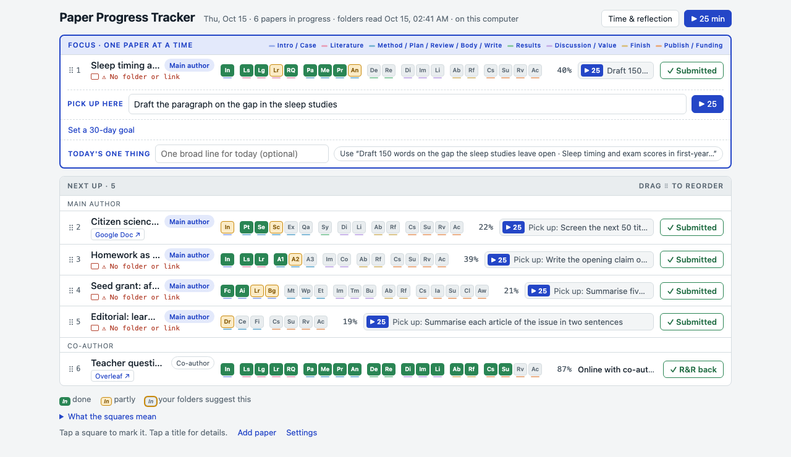

# Paper Progress Tracker

A free tracker for researchers who write many papers and grant proposals at once. It shows every paper as one line of progress squares, keeps one paper in focus, and breaks writing into 25-minute pieces you can actually finish.

It runs on your own computer, on Windows, Mac and Linux. There is no account and no cloud. Your data stays in plain files in the tracker's folder. The only thing you need to install is Python, which is free.



*The screenshot shows the tracker with the six example papers.*

## Contents

- [What it does](#what-it-does)
- [Download and start on Windows](#download-and-start-on-windows)
- [Download and start on Mac](#download-and-start-on-mac)
- [Start on Linux or with git](#start-on-linux-or-with-git)
- [How to stop it](#how-to-stop-it)
- [Where your data lives and how to back it up](#where-your-data-lives-and-how-to-back-it-up)
- [Settings](#settings)
- [Optional AI helper](#optional-ai-helper)
- [Troubleshooting](#troubleshooting)
- [Privacy](#privacy)
- [Optional, for Claude Code users](#optional-for-claude-code-users)
- [Files in this folder](#files-in-this-folder)

## What it does

### All your papers at a glance

- **One line per paper.** Each square is one part of the paper. Tap a square to mark it done or partly done.
- **Outlines that fit the paper type.** Each type has its own squares with short initials, for example In for Introduction or Ls for Search and reading. There are outlines for an empirical paper, a systematic review, a conceptual paper or chapter, and an editorial. Empirical and conceptual papers have a Literature section (search and reading, synthesis and gap, literature review written). The full key is in the app.
- **Grant proposals too.** The grant outline runs from checking the call and fit, through aims, background, methods, work plan, ethics, impact, team and budget, to sign-off, institution approval and submission. It says Awarded where a paper says Accepted, and Clarifications where a paper says R&R.
- **One paper in focus.** The top block holds the one paper you work on now. Drag the handle to rank the others. Drop a paper on Main author or Co-author to change your role.
- **One done button per paper.** It always offers the next milestone, such as Submitted, R&R back, Resubmitted or Accepted.

### Today and the next 30 days

- **Today's one thing.** One broad line for today, if you want one.
- **30-day goal.** Write one specific goal, rate how much it matters to you (0, 5 or 10), choose the squares that finish it, and add three small actions that make it easier. Tick the actions each day. On a day when life comes first, tap Life 10. That day never counts as missed. After 30 days you review the goal. The method follows the book The 6% Club.
- **Your record.** A small card with up to three real wins from your own records. It never compares you with anyone else.

### Writing in 25-minute pieces

- **Pieces with a coach.** Break a stage into pieces you can finish in one session. The coach flags vague pieces ("work on results") and asks you to name the result ("Draft 150 words on H4").
- **Routines per stage.** Most stages have a short routine, the same steps every time a paper reaches it. Add a step as a piece with one tap. The app says how strong the evidence for each step is.
- **Timer with a break.** 25 minutes of focus, a soft chime, then a 5-minute break (15 minutes after every fourth session). You can pause, add 5 minutes or finish early. A session counts when the time runs out, or after 20 minutes if you finish early.
- **Pick-up note.** When time is up, write where to start next time. The note waits on the paper in focus, with a button that starts 25 minutes from there.
- **Encouragement that is not flattery.** After each finished stage you see what you achieved and a short message based on research about motivation and writing. The sources are listed in the app.

### Time and reflection

- **Time log.** The timer logs your net time per paper. You can add other time by hand, such as teaching, peer review, admin or meetings. Core work and other work are counted apart, in the style of the scientist Alexander Lyubishchev, who logged his time this way for decades.
- **Weekly plan and promise.** Plan your core hours for the week and make one promise for one paper, with what you will deliver and by when. At the end of the week you mark whether you kept it.
- **Writing slot.** Pick your writing days and a start time. The tracker shows how many slots you kept.
- **Weekly and monthly reflection.** Five short questions each week, and a monthly look at plan against actual time.

### Your files and links

- **Folder reading that never changes your files.** Give each paper its folder. The tracker reads it when it starts and every few hours. It finds the latest version (it understands v01, v02, final and dates in file names), the word count change, your place in the author line, and hints such as a reviewer letter. It never changes, moves, renames or deletes your files.
- **Folder buttons.** Open folder, Open latest version and Choose folder work on Windows, Mac and Linux. On Linux the folder window needs zenity or kdialog. If the folder window cannot open, you can paste the folder path instead. A pasted folder must lie inside your user folder or inside your papers folder (`papersRoot` in the [settings](#settings)). For papers on another drive, set `papersRoot` to their folder there, or use Choose folder.
- **Links.** Add OneDrive, SharePoint, Google Docs or Drive, Overleaf or Dropbox links to any paper. You can mark a paper as moved to a shared online document, so older local drafts are not taken as the current version.
- **Links to files on your computer.** A paper can also link to a file or folder on your computer, for example the current draft of a grant proposal. In the paper's details, paste its path into the links box and click Add link. On Windows, select the file in File Explorer, right-click it and choose **Copy as path** (on Windows 10, hold Shift while you right-click). On a Mac, select it in Finder and press Option+Command+C. On Linux, copy the file in the file manager and paste it. One click on the link then opens the file in its own app, or the folder in your file manager. The tracker opens only folders and documents (such as Word, PDF, Excel, PowerPoint, pictures and data files), and only inside your user folder, inside your papers folder (`papersRoot`) or inside one of the paper's folders. Programs and scripts never open from a link. In the details, each file link has a Copy path button, so you can always open it yourself.
- **Journal list you load yourself.** Load a list of journals that count for you (.xlsx or .csv), for example your institution's list. Each paper then shows whether its target journal is on it.

### Safety nets

- **Undo everywhere.** Changes show a short message with an Undo button.
- **Nothing is erased.** Deleting never erases a record. It stays in your data folder, and removed files go to a trash folder there. The tracker also makes one backup zip of your data each day.
- **Optional AI helper, off by default.** It can suggest 25-minute pieces for a stage. The tracker works fully without it. See [Optional AI helper](#optional-ai-helper).

## Download and start on Windows

You do this once. After that, starting takes one double-click.

**1. Install Python (free).** Choose one way.

- **From python.org.** Go to [python.org/downloads](https://www.python.org/downloads/) and download Python for Windows. Run the installer. If it offers to add Python to PATH, say yes. In the classic installer this is a box on the first screen called **Add python.exe to PATH**. Tick it, then click Install Now.
- **From the Microsoft Store.** Open the Microsoft Store, search for Python, and install it from the Python Software Foundation.

You need Python 3.9 or newer. To check, press the Windows key, type `cmd` and press Enter. In the window, type `python --version` and press Enter. If that does not work, try `py --version`.

**2. Download the tracker.** On this project's GitHub page, click the green **Code** button, then **Download ZIP**.

**3. Unzip it.** Right-click the downloaded zip file and choose **Extract All**. Do not start the tracker from inside the zip file.

Choose a folder that is not synced to the cloud. On many Windows computers the Documents and Desktop folders are synced to OneDrive, and then your records would be uploaded there too. A good place is a new folder named PaperTracker in your own user folder. In the Extract All window, click **Browse**, type `%USERPROFILE%` in the address bar at the top and press Enter. Make a new folder named PaperTracker there, select it and click **Select Folder**, then click **Extract**.

Tip. Before you extract, you can right-click the zip, choose Properties, tick **Unblock** and click OK. Windows then asks fewer questions in step 5.

**4. Start it.** Open the extracted folder, and then the folder inside it whose name ends in `-main`. Double-click **start-windows.bat**.

**5. If Windows warns you.** Windows may say "Windows protected your PC". This happens because the file came from the internet and is not signed by a company. Click **More info**, then **Run anyway**. Windows may also say "The publisher could not be verified". Click **Run**. If you want to see what the file does first, right-click it and open it with Notepad. It is a short text file.

**6. Use it.** A black command window opens for a few seconds and then closes by itself. That is normal. Your browser shows the tracker at http://127.0.0.1:47285. Bookmark the page in your browser. The tracker keeps running in the background until you stop it with **stop-windows.bat** (see [How to stop it](#how-to-stop-it)). If something goes wrong, the command window stays open and says what happened.

The first start shows six example papers. Delete them when you are ready. Open a paper, then More, then Delete paper.

## Download and start on Mac

**1. Check for Python 3.** Open Terminal (in Applications, then Utilities). Type `python3 --version` and press Return.

- If it shows Python 3.9 or newer, you are ready.
- If macOS offers to install the "command line developer tools", click Install. They include Python 3. When the install has finished, check again.
- You can also install Python from [python.org/downloads](https://www.python.org/downloads/).

**2. Download the tracker.** On this project's GitHub page, click the green **Code** button, then **Download ZIP**. Safari usually unzips it for you. If not, double-click the zip file.

Move the unzipped folder to a place that is not synced to iCloud Drive. A good place is your home folder. In Finder, choose Go, then Home, and drag the folder there. If your Mac keeps Desktop and Documents in iCloud Drive, do not use those two folders, or your records would be uploaded there too.

**3. Start it the first time.** macOS checks files from the internet (this is called Gatekeeper). The tracker is not signed by an Apple-registered developer, so the first start takes a few extra clicks.

- Right-click (or Control-click) **start.command** and choose **Open**. In the message that appears, click **Open** again.
- On macOS 15 Sequoia and newer there may be no Open button. Click Done. Then open System Settings, go to Privacy & Security, scroll down, and click **Open Anyway** next to the message about start.command. Confirm with your password if asked.

You only do this once. Later, double-click start.command.

**4. Use it.** A Terminal window opens and your browser shows the tracker at http://127.0.0.1:47285. Bookmark the page. The Terminal window says that the tracker keeps running in the background. You can close that window. The tracker keeps running until you stop it with **stop.command** (see [How to stop it](#how-to-stop-it)).

macOS may ask whether Terminal or Python may access files in your Documents or Desktop folder. Click **Allow**, so the tracker can read your paper folders. It still only reads them.

The first start shows six example papers. Delete them when you are ready. Open a paper, then More, then Delete paper.

## Start on Linux or with git

On Linux, open a terminal in the tracker's folder and run

```bash
./start-linux.sh
```

It starts the tracker in the background and opens http://127.0.0.1:47285 in your browser. Run `./stop-linux.sh` to stop it. The Choose folder button needs zenity or kdialog, which most desktops have.

You can also run the server in the terminal itself with `python3 app/server.py`. Then press Ctrl+C in that terminal to stop it.

If you use git, you can get the tracker with

```bash
git clone https://github.com/NevergiveupGJ/paper-progress-tracker.git
```

To update later, run `git pull` in that folder. Your data, settings and AI key are not tracked by git, so an update never touches them.

## How to stop it

The tracker runs in the background, so closing the browser tab or the window that opened at the start does not stop it. Your changes are saved as you make them. Wait a second after your last change, then stop the tracker.

- **Windows.** Double-click **stop-windows.bat** in the tracker's folder.
- **Mac.** Double-click **stop.command** in the tracker's folder. The first time, macOS may ask about it as it did about start.command. Right-click it and choose Open, as in step 3.
- **Linux.** Run `./stop-linux.sh` in the tracker's folder. If you started it with `python3 app/server.py`, press Ctrl+C in that terminal.

A stop file stops only the tracker from its own folder. If you have two copies, for example an old version and a new one, stop each with the stop file in its own folder.

If the stop file cannot stop it, close it by hand. On Windows, open Task Manager (Ctrl+Shift+Esc), select Python and click End task. On a Mac, open Activity Monitor, select Python and click the stop button. Restarting the computer also stops it.

The messages from the last start are in `local/server.log` in the tracker's folder.

To uninstall, stop the tracker and keep a copy of your data if you want it. If you saved an AI key, remove it first (see [Switching it off](#switching-it-off)). Then delete the folder. Nothing else is installed on your computer, apart from Python and, if you used the AI helper, the small `ai.json` settings file listed under [Your key](#your-key), which you can delete too.

## Where your data lives and how to back it up

Your records live inside the tracker's folder. The AI key, if you add one, does not (see [Your key](#your-key)).

| Folder or file | What it holds |
|---|---|
| `data/` | Your papers, pieces, time log, goals and reflections, as plain JSON files. Created on first start. |
| `data/_trash/` | Records that were removed. Nothing is erased. |
| `backups/` | One zip of `data/` for each day the tracker runs. Old zips are kept. You can delete old ones by hand. |
| `config.json` | Your settings. Created on first start. |
| `local/` | The messages of the last start (`server.log`) and other working files for this computer. |

On Mac and Linux, `data/`, `backups/` and `local/` can be opened by your own user account only.

**Backing up.** The daily zips sit on the same computer, so they do not help if the computer is lost. Now and then, copy `data/`, `backups/` and `config.json` to a USB drive. If you copy them to a cloud service instead, your records are stored there.

**Restoring a backup.** Stop the tracker. Rename `data` to `data-old`. Make a new empty `data` folder and unzip one of the backup zips into it. Start the tracker.

**Moving to a new computer or a new version.** Download the tracker on the new computer or the new version into a new folder. Stop the old tracker. Copy `data/`, `backups/` and `config.json` from the old folder into the new one. Start the new tracker. On the same computer the AI settings carry over by themselves. On a new computer, set up the AI helper again if you use it.

**Cloud folders.** We suggest a folder that is not synced, as in the start steps. If you keep the tracker's folder in OneDrive, iCloud Drive or Dropbox anyway, your records and backups are uploaded to that service. The tracker also does not sync between computers, so run it on only one computer at a time.

## Settings

`config.json` in the tracker's folder holds your settings. It is created from `config.example.json` on first start, so you never have to copy it yourself. Every field is optional. The first thing to change is `names`. It starts as the example name Jane Doe, so replace it with your own name.

To change it, stop the tracker, open `config.json` in a plain text editor (Notepad on Windows, TextEdit on Mac), change the value, save, and start the tracker again.

| Field | Example | What it is for |
|---|---|---|
| `names` | `["Jane Doe", "J. Doe"]` | How your name appears in author lines. Used to find your place in the author line and to highlight you. |
| `papersRoot` | `"~/Documents/Papers"` | The folder that holds your paper folders. New folders there are offered as new papers. `~` means your own user folder, on Windows and Mac. |
| `port` | `47285` | The tracker's address is http://127.0.0.1:47285. Change the number if another program already uses it. |
| `scanEveryHours` | `6` | How often the tracker reads your folders again while it runs. `0` means only when it starts. |
| `journalListName` | `"journal list"` | What to call your journal list in the app. |
| `onlineUrl` | `""` | An optional link shown at the top of the page, for example to an online copy. |

A full example.

```json
{
  "names": ["Jane Doe"],
  "papersRoot": "~/Documents/Papers",
  "port": 47285,
  "scanEveryHours": 6,
  "journalListName": "journal list"
}
```

On Windows, write folder paths with forward slashes, for example `"C:/Users/Jane/Documents/Papers"`, or with double backslashes. A single backslash breaks the file. If OneDrive backs up your Documents folder, your papers may be in `"~/OneDrive/Documents/Papers"`.

## Optional AI helper

The AI helper is **off** when you download the tracker. Everything else works without it, and many people never switch it on.

**What it does.** In a paper's details, the **Break down with AI** button asks the AI to break the current stage into 5 to 8 pieces of 25 minutes. The pieces are added to your list, and Undo removes them again. The helper suggests tasks. It does not write your paper.

### Your choices

| Choice | Cost | Privacy | What you need |
|---|---|---|---|
| **Off** (default) | Free | No AI requests are sent. | Nothing |
| **Claude** (Anthropic) | Paid by use. Needs an API key with credit. | The text of each request goes to Anthropic. | Internet and an API key |
| **OpenAI or compatible** | Paid by use. Needs an API key with credit. | The text of each request goes to OpenAI, or to the service whose address you enter. | Internet, an API key and a model name |
| **Ollama** (on your computer) | Free | Stays on your computer. | Ollama installed, a model downloaded, and a capable computer |

Please note.

- A Claude Pro or Max subscription, or a ChatGPT Plus subscription, does **not** include API use. API keys are billed separately, by use.
- One request is short. With a mid-size online model it usually costs a few US cents or less. Prices change, so check the provider's price page.
- Online providers have their own terms on how long they keep request data. Read them before you switch on an online provider.
- Ollama is free and private, but it runs the model on your own computer. A small model needs roughly 4 to 8 GB of free memory, so 16 GB of memory or a recent Apple silicon Mac is comfortable. Small models give weaker suggestions than the large online models.

### Setting it up

In the tracker, click **Settings** at the bottom of the page. Under AI helper (optional), choose a provider, fill in the boxes, click Save, then click Test.

- **Claude.** Create an account in the [Claude Console](https://platform.claude.com), add credit and create an API key. Paste the key. The model box is filled in with a current Sonnet model. You can type another model name.
- **OpenAI or compatible.** Create an API key at [platform.openai.com](https://platform.openai.com) and add credit. Paste the key and type a model name. The address `https://api.openai.com/v1` is filled in. For another service with an OpenAI-compatible address, type its address instead.
- **Ollama.** Install Ollama from [ollama.com](https://ollama.com). In a terminal, download a model, for example `ollama pull llama3.2`. In the tracker, choose Ollama and type the model name exactly as `ollama list` shows it. The address `http://127.0.0.1:11434/v1` is filled in. No key is needed.

### What is sent, and what is never sent

A request goes out only when you click the AI button. Nothing is sent in the background. Test only checks your key and the connection. It sends none of your text.

**What is sent.** The request is about one paper. It holds that paper's title, its outline and current stage, which parts are done, your next-step note, the pieces you already have, and the version label and word count of the latest version the folder reading found (for example "v03, 6,200 words").

**What is never sent.** Your files or their contents, file and folder names, your links, the "What I know about this paper" cards (they can name co-authors and files), your other papers, your time log, your goals and reflections, and your settings.

### Your key

Your key is stored in a file named `ai.json` in a settings folder of your user account, outside the tracker's folder. So it is never in `data/`, in the daily backups, in git, or in a copy of the tracker's folder, and a tracker folder in OneDrive or iCloud Drive does not upload it.

| System | Where the file is |
|---|---|
| Windows | `%LOCALAPPDATA%\PaperProgressTracker\ai.json` |
| Mac | `~/Library/Application Support/PaperProgressTracker/ai.json` |
| Linux | `~/.config/paper-progress-tracker/ai.json` |

The key is stored as plain text in that file. On Mac and Linux the file can be read only by your user account. On Windows it has the protection of your user folder, which other standard accounts cannot open. The key goes only to the provider you chose, with each request. The tracker page never receives it and shows only its last four characters. Every copy of the tracker on this computer and user account uses the same AI settings.

### Switching it off

Open the AI helper settings and choose **Off**. No more requests are sent. Your key stays saved in case you switch back. To delete the key as well, use Remove key in the same settings, or stop the tracker and delete the `ai.json` file shown above.

## Troubleshooting

**The page does not open, or the browser says it cannot reach the site.** The tracker is not running. Start it again. Check the address. It is http://127.0.0.1:47285 (http, not https), or your own port if you changed it. If it still does not start, look at `local/server.log` in the tracker's folder.

**The command window closed by itself (Windows).** That is normal when the start worked. The tracker keeps running in the background. If the start fails, the window stays open and says why.

**Windows says "Python was not found".** Install Python as in step 1 and let it add Python to PATH. If you used the classic installer and Python is installed already, run the installer again, choose Modify, and turn on "Add Python to environment variables". Then start the tracker again.

**Windows blocks start-windows.bat.** See step 5 above. You can also unblock the zip before you extract it (right-click, Properties, Unblock).

**Mac says start.command cannot be opened, or is from an unidentified developer.** Follow step 3 above. Another way that always works is to open Terminal, type `bash ` (with a space), drag start.command into the Terminal window, and press Return.

**Mac says "permission denied".** Use the `bash ` way just above.

**"Another program already uses port 47285".** Some other program on your computer has taken the tracker's port. Change `port` in `config.json`, for example to 47286, and start again.

**"Another copy of Paper Progress Tracker already runs on port 47285".** An older version, or a second copy in another folder, is running. Stop it with the stop file in its own folder, then start this one. Or give this copy another `port` in its `config.json`.

**Choose folder shows nothing.** The folder window can open behind your browser. On Windows, press Alt+Tab to find it. On a Mac, look in the Dock. If it cannot open, the tracker offers a box where you can paste the folder path. A pasted folder must lie inside your user folder or inside `papersRoot`.

- On Windows, select the folder in File Explorer, right-click it and choose **Copy as path**. On older Windows, hold Shift while you right-click.
- On a Mac, select the folder in Finder and press Option+Command+C.

**My folders are not read on a Mac.** You may have clicked Don't Allow when macOS asked about the Documents or Desktop folder. Open System Settings, then Privacy & Security, then Files and Folders, and turn on access for Terminal (or Python). Stop the tracker with stop.command and start it again.

**A link to a file on my computer does not open.** The message says why.

- "Not there any more" means the file was moved or renamed. Remove the link and add it again with the new path.
- "For another computer" means the path was made on another system, for example a Windows path on a Mac. It opens only on that computer.
- The tracker opens only folders and documents inside your user folder, inside `papersRoot` or inside one of the paper's folders. For anything else, click Copy path and open it in File Explorer or Finder yourself.

**The latest version or word count is missing.** Versions and word counts come from Word files (.docx). Other files are recognised by name only. Files kept only in the cloud (for example OneDrive files that are not downloaded) may be skipped.

**The journal list does not load.** A .csv file works offline. An .xlsx file needs the internet once, to load the free reader for Excel files.

**No chime when the timer ends.** Browsers play sound only after you have clicked on the page once. Keep the tracker tab open while the timer runs.

**The AI helper shows an error.**

| Message is about | What to try |
|---|---|
| the key | Check that you pasted the whole key and that your account has credit. |
| the connection | Check your internet. For Ollama, check that Ollama is running. |
| too many requests | Wait a minute and try again. |
| an answer it cannot read | Check the model name. Try another model. |
| too much text | The request was too long. Shorten your next-step note or your list of pieces. |
| switched off | The AI helper is off. Switch it on in its settings. |

## Privacy

Your papers, notes and other records stay on your computer. The tracker sends them nowhere unless you switch on an online AI provider. The page itself fetches from the internet only what the list says.

- The tracker answers only on your own computer (127.0.0.1). Other computers on your network cannot open it.
- It never uploads your papers, your files or your data. There is no account, no analytics and no tracking.
- It reads your paper folders and never changes them.
- The page uses the fonts already on your computer. It loads no fonts from the internet.
- When you load an .xlsx journal list, the page loads the free SheetJS reader from cdnjs. The browser checks that it is the exact published file before it runs it. Your file is read in your browser and is not uploaded. A .csv list needs no download.
- Links to sources, to your online documents and to files on your computer open only when you click them.
- If you switch on Claude or OpenAI, the text of each AI request goes to that company, as described in [What is sent](#what-is-sent-and-what-is-never-sent). With Ollama, it stays on your computer.
- If the tracker's folder is in OneDrive, iCloud Drive or Dropbox, that service stores a copy of your records. See [Cloud folders](#where-your-data-lives-and-how-to-back-it-up).
- Websites cannot use the tracker. It refuses requests from other sites and cannot be shown inside another site's page.

**Use it on a computer you do not share.** Other websites cannot reach the tracker, but programs that run on your computer can, including programs of other user accounts on the same computer. Such a program could read your records or make AI requests on your key while the tracker runs, although the tracker never hands out the key itself. Keep the tracker's folder inside your own user folder, as in the start steps. On a shared Windows computer, a folder outside your user folder (for example `C:\PaperTracker`) can be opened by every account.

## Optional, for Claude Code users

The "What I know about this paper" cards in each paper's details are plain JSON files in `data/context/`. Any tool can write them. If you use Claude Code, [docs/claude-code-daily-task.md](docs/claude-code-daily-task.md) has a template for a daily task that reads your folders and writes these cards. It is optional, and the tracker works fine without it.

## Files in this folder

| Path | Role |
|---|---|
| `start-windows.bat`, `stop-windows.bat` | Start and stop the tracker on Windows. |
| `start.command`, `stop.command` | Start and stop the tracker on Mac. |
| `start-linux.sh`, `stop-linux.sh` | Start and stop the tracker on Linux. |
| `app/launcher.py` | What the start and stop files run. It finds the port, starts the server in the background, opens your browser and stops the server again. |
| `app/source.html` | The whole page (HTML, CSS and plain JavaScript). |
| `app/build_local.py` | Builds `app/index.html` from `app/source.html`. The server does this for you when needed. |
| `app/server.py` | The small local server. It stores your data, opens folders and runs the optional AI helper. Python standard library only. |
| `scan_folders.py` | The read-only folder reader. |
| `config.example.json` | The settings template. `config.json` is made from it on first start. |
| `sample-data/` | The six example papers for the first start. |
| `docs/CHANGELOG.md` | What is new in each version. |
| `docs/claude-code-daily-task.md` | Optional template for Claude Code users. |
| `docs/screenshot.png`, `docs/logo.png`, `app/logo.png` | The pictures in this README and the page icon. |
| `README.md`, `LICENSE`, `.gitattributes`, `.gitignore` | This guide, the license and the git settings. |

## Credits

Built by [@NevergiveupGJ](https://github.com/NevergiveupGJ) with Claude Code. The encouragement messages draw on work by Amabile and Kramer, Kivetz and colleagues, Locke and Latham, Gollwitzer and Sheeran, Mueller and Dweck, Deci and colleagues, Breines and Chen, Boice, Sword, Silvia, Belcher, Wohl and colleagues, Walton and Cohen, and others. The time log follows Alexander Lyubishchev's method. The 30-day goal follows the book The 6% Club, with habit timing from Lally and colleagues (2010). Full references are in the app.

## License

MIT, see [LICENSE](LICENSE).
